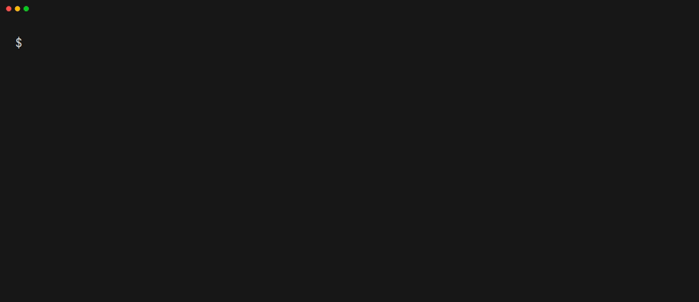

<p align="center">
  <picture>
    <source media="(prefers-color-scheme: dark)" srcset="assets/rbai-cli-logo-dark.svg">
    
  </picture>
</p>

<p align="center">
  RBAi, the research assistant for the life sciences, in your terminal.
</p>

<p align="center">
  <a href="https://www.npmjs.com/package/rbai-cli"></a>
  <a href="https://rbai.thedreamlabinnovations.com/docs/cli-access"></a>
  <a href="CHANGELOG.md"></a>
  <a href="https://doi.org/10.5281/zenodo.24590545"></a>
</p>

<p align="center">
  
</p>

You ask a research question in plain words. RBAi looks it up in biology databases such as UniProt, PDB, ClinVar,
Ensembl, ChEMBL and PubMed, runs an analysis in a private cloud sandbox when it needs one, and writes an answer with
links back to the records. The RBAi CLI, the command `rbai`, brings this to your terminal, to your scripts and to the
AI agent in your code editor.

It is the same RBAi as the web app at [rbai.thedreamlabinnovations.com](https://rbai.thedreamlabinnovations.com),
with the same account. A conversation you start in the terminal also appears in the web app, and the other way
round. If you start `rbai` in a folder, it can also work with the files and programs on your computer, and by
default it asks you before every change.

This repository is the CLI's public home. It holds the install steps, the documentation and the changelog, the
installer scripts, the kit that connects RBAi to AI coding tools, and the place to report problems. The CLI itself
is closed source, so its program code isn't here.

## Install

You only need one of these.

**macOS or Linux** (also Windows Subsystem for Linux). Open a terminal and run:

```sh
curl -fsSL https://cli.thedreamlabinnovations.com/install.sh | sh
```

**Windows.** Open **Terminal** (press the Windows key and type *Terminal*). Run this as yourself, not as
administrator:

```powershell
irm https://cli.thedreamlabinnovations.com/install.ps1 | iex
```

**npm.** If you already use Node.js 22 or later:

```sh
npm install -g rbai-cli
```

The installer doesn't need Node.js. It downloads the build for your computer from `cli.thedreamlabinnovations.com`,
checks its SHA-256 checksum (a fingerprint that shows the file arrived unchanged), checks that it starts, and
installs it for your user account only. You can read both installer scripts in [`install/`](install/) before you
run them. When it has finished, open a new terminal so that the `rbai` command is found, and run `rbai --version`.

There are builds for Windows, Linux and macOS, on Intel, AMD and Arm processors. If one doesn't start for you,
please [tell us](https://github.com/Insightwithhari/rbai-cli/issues/new/choose).

`rbai update` looks for a newer version and, if you say yes, updates rbai the same way you installed it. To install
a given version or into another folder, see [install/README.md](install/README.md).

## Get started in three steps

1. **Sign in.** Run `rbai auth login`. Your browser opens RBAi. Check that the code it shows matches the code in
   your terminal, and approve. You need an RBAi account, and there is a free plan. On a computer without a browser,
   for example over SSH, run `rbai auth login --no-browser` and open the link it prints on any device.
2. **Start the chat.** Run `rbai`.
3. **Ask a question** and press Enter. For example:

   ```text
   What is known about TP53 R175H in Li-Fraumeni syndrome?
   ```

   RBAi shows each tool it uses, such as a database lookup, with what came back, and then writes the answer. The
   line under the answer says how many credits it used and how long it took. Press `Esc` to stop an answer and
   `Ctrl-D` to leave.

Type `/help` in the chat to see every chat command. You can also ask one question without opening the chat:

```sh
rbai ask "Summarise the function of BRCA1 in two sentences"
```

AI answers can contain mistakes. Check an important result against the records the answer links to before you rely
on it.

## Questions to try

Copy any of these into your terminal. Each question uses credits from your plan. To see what RBAi does and what it
answers, look at the [examples](examples/).

| What you want | What to type |
| --- | --- |
| What is known about a variant | `rbai ask "What is known about TP53 R175H in Li-Fraumeni syndrome?"` |
| A list of drugs, with sources | `rbai ask "List the known PD-L1 inhibitors"` |
| Check a predicted structure | `rbai ask "How confident is the AlphaFold model of human KRAS, and which regions are least certain?"` |
| A literature review | `rbai review create "CRISPR off-target effects in primary human T cells" --level medium --wait` |
| An analysis on your own Galaxy account | `rbai galaxy ask "Run FastQC on the two FASTQ files in my newest history"` |
| A question about a file on your computer (run it in the folder that holds the file) | `rbai ask "Which samples in counts.csv have fewer than 1,000 reads?" --local` |
| Who has a reagent | `rbai connect ask "Who distributes a validated anti-GPX4 antibody for mouse tissue?"` |

For step-by-step lessons on real data, see the free [RBAi Academy](https://thedreamlabinnovations.com/academy).

## What it can do

- **Answer research questions with live data.** RBAi uses live tools for UniProt, PDB, ClinVar, Ensembl, ChEMBL,
  PubMed and other databases. Every tool call is shown with what it returned, and the answer links back to the
  records.
- **Run analyses** in a private cloud sandbox that belongs to the chat, with Python, R, samtools, DESeq2, scanpy and
  more. Files it makes, such as tables, figures and Word or Excel files, are links you can download.
- **Write literature reviews.** `rbai review create` searches the literature and writes a review that cites the
  papers it read. You can follow it while you keep working, export it, and ask questions about its papers.
- **Run Galaxy tools and complete Galaxy workflows** with your own Galaxy account, on usegalaxy.eu, usegalaxy.org or
  any other Galaxy server.
- **Work with protein structures** in Structure Studio, and dock small molecules with AutoDock Vina. Docking scores
  are estimates, not measured binding energies.
- **Make slides, figures and Report Writer pages** from your projects and reviews, and change a chat's figure with
  Edit with AI (`rbai plot edit`).
- **Find labs** whose published methods used a reagent or an instrument (Connect). An email it drafts is never sent
  from the terminal: you check it and send it yourself in the web app.
- **Keep going on long tasks.** A long answer keeps working past 15 minutes, on RBAi's server, and the CLI follows it
  to the end.
- **Hand work to agents.** RBAi can give a task to an agent that works in the background, with a budget and a
  deadline that it tells you. When the agent finishes, RBAi replies in the chat. `/specialists` shows each agent's
  state and report.

## Skills

RBAi follows expert procedures called skills. A skill is a written method for one kind of task, such as an RNA-seq
analysis with DESeq2, primer design or molecular docking. When a question matches a skill, RBAi uses it and works
through its steps. To see the skills and read one:

```sh
rbai skill list
rbai skill show rnaseq-deseq2
```

You can check which skills a question would use before you ask it. This runs nothing and uses no credits:

```sh
rbai skill preview "find the differentially expressed genes in my counts table"
```

To make RBAi follow one skill, give its id with `--skill`. Like every question, this one uses credits:

```sh
rbai ask --skill primer-design "Design qPCR primers for human GAPDH"
```

Your lab's own method can be a skill too. Write it as a SKILL.md file and add it, together with any reference files
it needs, such as your protocol. `rbai skill list --mine` then shows it:

```sh
rbai skill create SKILL.md --reference protocol.md
```

`rbai skill update <id> SKILL.md` replaces your skill, and `rbai skill delete <id>` removes it. In the chat, `/skills`
shows the list, and `@` tags a skill in your message.

These skills are for RBAi itself. The agent skill in [`skills/rbai/`](skills/rbai/) is a different thing: it teaches
other AI tools, such as Claude Code or Kiro, how to use `rbai`. The section
[Use RBAi from your AI coding tool](#use-rbai-from-your-ai-coding-tool) says how to add it.

## Work with the files on your computer

Start `rbai` in a folder, and it can read, search and edit the files there and run your own programs, such as
`python qc.py`, `samtools flagstat` or the tools in your conda environment. All of RBAi's cloud tools stay available
too.

```sh
cd ~/data/kidney-atlas
rbai
```

The first time in a folder, RBAi asks whether it may work there: yes, read only, or no. After that it asks before
every change, every command and every upload, and the box shows exactly what will happen, such as the command and
the folder it runs in, or the lines of a file it wants to change. `/undo` puts back the file it changed last.
`Shift+Tab` switches between four modes: ask before changes (the default), edit without asking, plan first, and
read only. These rules are checked by `rbai` on your computer, never by the AI.

**Background jobs.** For a command that takes a long time, such as an alignment, a Nextflow pipeline or a large
download, RBAi can start a background job. The job keeps running after you close rbai and the terminal. Later, ask
RBAi "is my job finished?", or run `rbai jobs`. A computer that sleeps pauses a job, and a restart ends it.

**From the website.** `rbai bridge` lets a chat on the website work in a folder on this computer, or on your lab's
Linux server, and every change waits for your approval in the browser.

The full guide to working in a folder is in the
[user guide](https://rbai.thedreamlabinnovations.com/docs/cli-access).

## Use RBAi from your AI coding tool

The agent kit in this repository teaches AI coding agents how to use `rbai`, and connects them to RBAi's MCP server.
MCP, the Model Context Protocol, is the standard way for AI tools to call outside tools. Install `rbai` and sign in
first, then:

| Tool | How to add RBAi |
| --- | --- |
| Claude Code | `/plugin marketplace add Insightwithhari/rbai-cli`, then `/plugin install rbai@thedreamlabinnovations` |
| Kiro | In the Powers panel, choose **Add Custom Power**, then **Import power from GitHub**, and paste `https://github.com/Insightwithhari/rbai-cli`. For the skill alone, run `rbai agent-skill --client kiro --write`. |
| Gemini CLI | `gemini extensions install https://github.com/Insightwithhari/rbai-cli` |
| Codex | `rbai agent-skill --client codex --write`, then add the block in [codex/config.toml](codex/config.toml) to `~/.codex/config.toml` |
| Cursor | `rbai agent-skill --client cursor --write`, then `rbai mcp config --client cursor` for the MCP settings |
| VS Code with GitHub Copilot | `rbai agent-skill --client vscode --write`, then `rbai mcp config --client vscode` for the MCP settings |
| Claude Desktop or another MCP client | `rbai mcp config --client claude-desktop` prints the settings to paste. Any MCP client can start the server with the command `rbai mcp serve`. |

Every MCP setting starts `rbai mcp serve`, which uses the sign-in from `rbai auth login`, so no key goes into your
editor's settings. What each file of the kit is for: [docs/agent-kit.md](docs/agent-kit.md).

## Use it in scripts

Every command can print JSON and returns a stable exit code, so scripts and CI can use it. Data goes to standard
output and messages go to standard error. With `-q`, `rbai ask` prints the answer and nothing else:

<p align="center">
  
</p>

```sh
rbai project list -o json
rbai ask "List the known PD-L1 inhibitors" --output-format json
```

In CI, set the `RBAI_API_KEY` environment variable to a key from **Settings → API keys** instead of signing in. The
exit codes and every flag are in [docs/reference.md](docs/reference.md).

## Documentation

- [User guide](https://rbai.thedreamlabinnovations.com/docs/cli-access): install, sign in, the chat, working in a
  folder, and troubleshooting.
- [docs/reference.md](docs/reference.md): every command, flag, default, exit code and environment variable. The same
  text as `rbai help reference`.
- [docs/agents.md](docs/agents.md): the guide for AI agents and scripts. The same text as `rbai help agents`.
- [CHANGELOG.md](CHANGELOG.md): what changed in each version.

## Plans and credits

RBAi counts its work in credits, and every answer shows the credits it used. There is a free plan, and there are paid
Student, Researcher and Pro plans. The [pricing page](https://rbai.thedreamlabinnovations.com/pricing) has the
current prices and what each plan includes.

## Data and privacy

- **No telemetry.** The CLI doesn't send usage statistics. It talks to the RBAi service you sign in to, to the
  storage links the service gives it for your files, and once a day to check for a newer version (the npm registry,
  or `cli.thedreamlabinnovations.com` if you used the installer). `RBAI_NO_UPDATE_CHECK=1` turns that check off.
- **Your account.** Your questions, the files you attach and your chats are kept in your RBAi account until you
  delete them. In the web app, **Settings → Data & privacy** lets you export your workspace or delete everything in
  it.
- **Your folder.** Your files stay on your computer, and `rbai` doesn't copy or sync the folder. What RBAi reads to
  answer you is sent with the chat and saved with it until you delete the chat: the lines it reads, the file names it
  lists, what its searches find and each command's output. A whole file goes to the cloud sandbox only when you say
  yes.
- **Your sign-in.** `rbai auth login` gives the CLI its own API key, named after your computer. You can see and
  revoke it in **Settings → API keys**, and `rbai auth logout` revokes it. The key is stored in your user's settings
  folder, readable only by you.
- **Who processes it.** RBAi runs on cloud providers, and the AI models that answer you are hosted by providers such
  as Microsoft Azure, Amazon Web Services and Cloudflare. We don't sell your personal data.

The full details are in the [Privacy Policy](https://rbai.thedreamlabinnovations.com/privacy) and the
[Terms](https://rbai.thedreamlabinnovations.com/terms).

## Report a problem

- Run `rbai doctor` first. It checks your installation, your settings, the network and your sign-in, and says how to
  fix what fails.
- [Open an issue](https://github.com/Insightwithhari/rbai-cli/issues/new/choose). The form asks for your
  `rbai --version`, your operating system, how you installed rbai, the command and what it printed.
- Never paste an API key, a sign-in code or a token into an issue.
- For questions about your account or your plan, email
  [hari@thedreamlabinnovations.com](mailto:hari@thedreamlabinnovations.com).

More ways to get help: [SUPPORT.md](SUPPORT.md).

## Security

Please report a security problem privately, as [SECURITY.md](SECURITY.md) explains, and not in a public issue.

## Licence

The RBAi CLI is proprietary software of The Dream Lab Innovations. It is free to install and use with an RBAi
account under the [RBAi Terms of Service](https://rbai.thedreamlabinnovations.com/terms), but it is not open source,
and its source code is not in this repository. You may copy the agent kit and the installer scripts in this
repository into your own projects to use RBAi. [LICENSE.md](LICENSE.md) says which files you may copy and what
you may do with each.

## How to cite

If RBAi helped your research, you can cite the CLI. Each version has its own DOI on
[Zenodo](https://doi.org/10.5281/zenodo.24590545), and that link always leads to the newest one. GitHub's
**Cite this repository** button, in the right-hand column of this page, gives a citation in APA and BibTeX from
[CITATION.cff](CITATION.cff). Please cite the version you used, which `rbai --version` prints. For example:

> Chaudhary, H. (2026). *RBAi CLI* (Version 1.6.9) [Computer software]. The Dream Lab Innovations.
> https://doi.org/10.5281/zenodo.24590546

## Who makes RBAi

RBAi is made by [The Dream Lab Innovations](https://thedreamlabinnovations.com), founded by Hariom Chaudhary, a
computational biologist. It is built for students and scientists in biology and medicine.

## Prefer the browser?

RBAi also runs in your browser at [rbai.thedreamlabinnovations.com](https://rbai.thedreamlabinnovations.com), with
the same account and the same conversations, and nothing to install.
